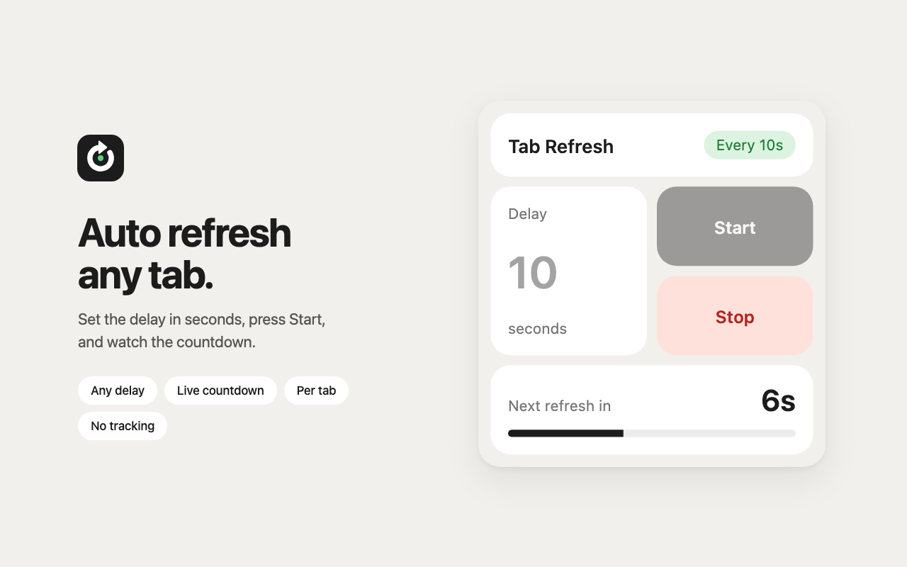
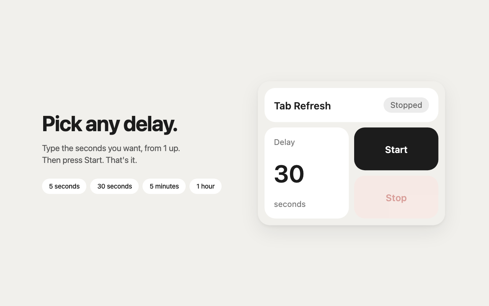
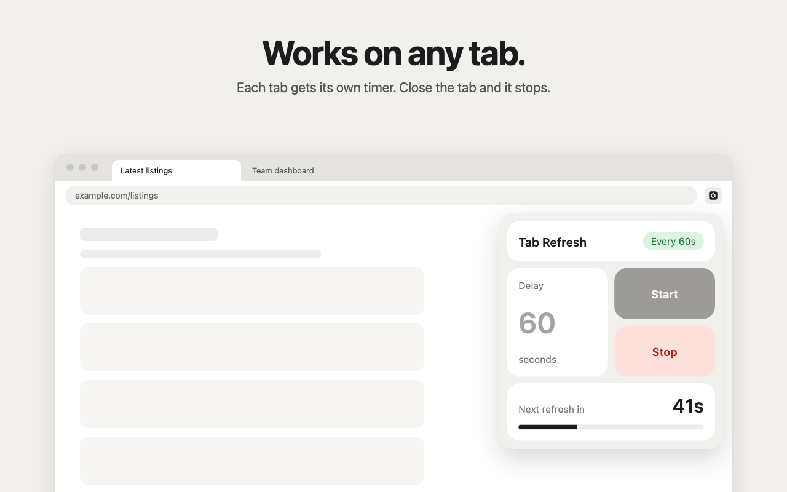

<p align="center">
  
</p>

<h1 align="center">Tab Refresh</h1>

<p align="center">A simple Chrome extension that auto refreshes a tab on a timer, with a live countdown.</p>



## Features

- Any delay, from 1 second up
- Live countdown to the next refresh
- Each tab runs on its own timer
- Stops by itself when the tab is closed
- No tracking, no account, no data collected

## Screenshots

| Set a delay | Works on any tab |
| --- | --- |
|  |  |

## Install from source

1. Clone or download this repo.
2. Open `chrome://extensions` and turn on **Developer mode**.
3. Click **Load unpacked** and select the repo folder.

## How to use

1. Open the tab you want to refresh.
2. Click the Tab Refresh icon.
3. Type the delay in seconds and press **Start**.
4. Press **Stop** when you are done.

## Build

```sh
./package.sh
```

This creates `dist/tab-refresh-<version>.zip`, ready to upload to the Chrome Web Store.

## Privacy

Tab Refresh does not read pages or send any data. See the [privacy policy](store/privacy-policy.md).

## License

[MIT](LICENSE)
